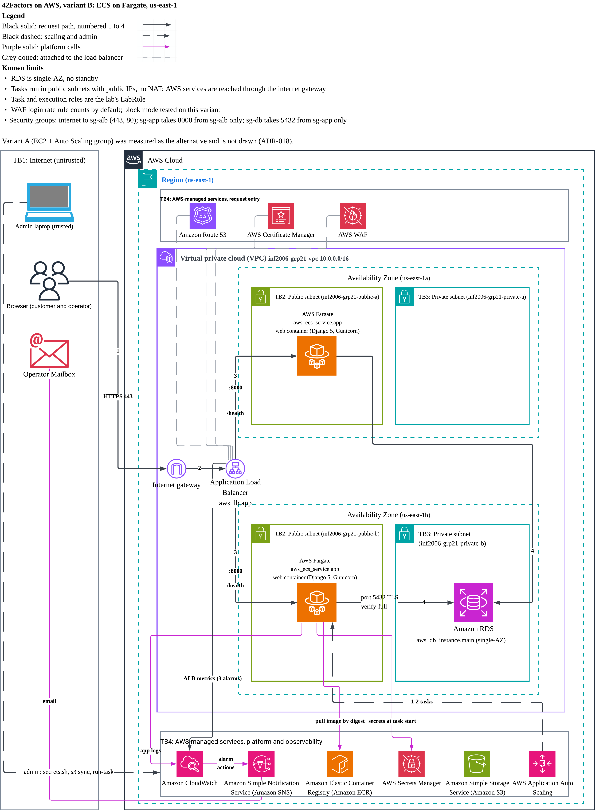
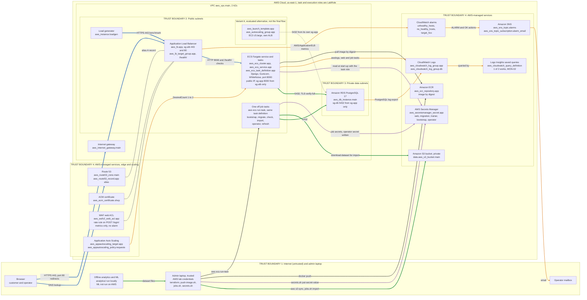

# Architecture diagram: 42Factors shop on AWS (final architecture, variant B)

The one architecture diagram required by the brief (section 5.1) is [architecture.png](architecture.png) (3600 x 2730 px, 300 dpi, drawn by [architecture.src.py](architecture.src.py)). This page is its text version: the same content as a Mermaid diagram, a table that ties every label to a Terraform resource and to the evidence that tests it, and the facts the diagram rests on.

**What is drawn.** The final architecture is **variant B**, the Django container on Amazon ECS with Fargate behind an Application Load Balancer, with a private RDS PostgreSQL ([ADR-018](../docs/decisions/ADR-018-final-architecture-ecs-fargate.md)). **Variant A** (EC2 + Auto Scaling group) was built from the same shared module and measured as the alternative; it is the small dashed box. Names in the diagram are Terraform resource names from `src/infrastructure/` and the 13 `architecture.components` of [project_manifest.yaml](../project_manifest.yaml). No account ID, IP address or secret value is shown. Not everything is Terraform: the S3 bucket itself, the secret values and two service-linked roles (ECS and Application Auto Scaling) are set by CLI ([runbook](aws-build-runbook.md#procedures), `scripts/secrets.sh`, [PRE slr-create](raw/PRE_2026-10-08_slr-create.txt)). Task and execution roles are the lab's `LabRole`.

## Trust boundaries

| # | Boundary | Contains | Why it is a boundary (Terraform) |
|---|---|---|---|
| 1 | Internet (untrusted), plus the admin laptop | Browser (customers and operator), the operator mailbox, `analytics/` and the admin laptop (trusted: it holds the AWS lab credentials and runs Terraform, `push-image.sh`, `jobs.sh`, `secrets.sh`) | Everything here is outside AWS and the VPC; the laptop is the only trusted party. Only `sg-alb` accepts traffic from `0.0.0.0/0` (443 and 80): `modules/web-entry/security_groups.tf` `alb_https`, `alb_http` |
| 2 | Public subnets, 2 AZs | ALB, Fargate tasks (with public IPs), one-off job tasks, load generator, variant A | `aws_subnet.public` and a route table with `0.0.0.0/0` to `aws_internet_gateway.main` (`base/network.tf`). The tasks have public IPs (`assign_public_ip = true`, `fargate/ecs.tf:106`) so they reach AWS APIs without a NAT gateway, but `sg-app` accepts port 8000 only from `sg-alb` (`app_from_alb`, `security_groups.tf:53`) |
| 3 | Private data subnets, 2 AZs | RDS PostgreSQL | `aws_subnet.private` with a route table that has only the local route (`base/network.tf`); `publicly_accessible = false` (`base/database.tf:56`); `sg-db` accepts 5432 only from `sg-app` (`db_from_app`, `security_groups.tf:82`) and has no egress rule |
| 4 | AWS-managed services | Route 53, ACM, WAF, Application Auto Scaling, ECR, Secrets Manager, S3, CloudWatch (Logs, alarms, Logs Insights), SNS | Not in the VPC (`aws_vpc.main` contains boundaries 2 and 3 only). Reached over HTTPS 443 on public endpoints (`sg-app` egress rule `app_https`); S3 refuses non-TLS requests (`base/storage.tf`, `DenyInsecureTransport`) |

The security-group chain, in every stack: internet, then `sg-alb` (443 and 80), then `sg-app` (8000), then `sg-db` (5432). There is no port 22 anywhere and no SSH. Variant B has no Systems Manager path; variant A uses Session Manager and SSM Run Command, which are not drawn.

## Diagram as text (Mermaid)

Arrow colours (same as the image): blue user traffic, green data, orange logs and metrics, purple secrets, black deploy-time, grey dashed variant A, grey line without a head an attachment (certificate, web ACL, Route 53 alias on the ALB). Thick arrows are the main request path. Arrows point from the caller to the service it calls. Application Auto Scaling is fed by the ALB request metric; only its last hop (to the ECS service) is drawn.

## Label to Terraform to evidence

Paths under "Terraform" are relative to `src/infrastructure/`. "Evidence" files are in `evidence/` (the `raw/` files are the unedited command output; the records are linked in the last column). Everything is variant B unless stated. "#" is the entry in `architecture.components` of the manifest (1 to 13, in order).

| Label in the image | AWS service | Terraform resource or file | Evidence that tests it | # |
|---|---|---|---|---|
| Browser | none (client) | none | [FUNC-03 B purchase flow](raw/FUNC-03_2026-10-09_fargate_summary.txt) (2 orders, 0 errors) | 1 |
| Route 53 `aws_route53_zone.main`, `aws_route53_record.app` (alias A record) | Route 53 | `base/dns.tf`; `modules/web-entry/alb.tf` (`aws_route53_record.app`, hostname `shop-fargate.<domain>` from `base/certificate.tf` `shop_hostnames`) | [SEC-10 smoke](raw/SEC-10_2026-10-09_fargate_smoke.txt) (HTTPS request to the hostname) | 3 |
| ACM certificate `aws_acm_certificate.shop` | AWS Certificate Manager | `base/certificate.tf` (also `aws_route53_record.cert_validation`, the DNS validation records in the Route 53 zone, and `aws_acm_certificate_validation.shop`) | [SEC-10 listeners](raw/SEC-10_2026-10-09_fargate_listeners.txt) | 3 |
| WAF web ACL `aws_wafv2_web_acl.app` | AWS WAF (regional) | `modules/web-entry/waf.tf` (rule `login-rate-limit`; `aws_wafv2_web_acl_association.app` attaches it to the ALB) | [SEC-17 burst](raw/SEC-17_2026-10-09_fargate_burst.txt), [metrics](raw/SEC-17_2026-10-09_fargate_metrics.txt) (block mode; count is the default) | 2 |
| Application Load Balancer `aws_lb.app`, `aws_lb_target_group.app`, listeners 443 and 80 | Elastic Load Balancing | `modules/web-entry/alb.tf` (`aws_lb_listener.http` redirects 301; `aws_lb_listener.https` TLS policy `ELBSecurityPolicy-TLS13-1-2-2021-06`) | [SEC-10 listeners](raw/SEC-10_2026-10-09_fargate_listeners.txt); health check in [RES-03b replacement](raw/RES-03-fargate-replace-r1_2026-10-09/) | 3 |
| `sg-alb`, `sg-app`, `sg-db` | EC2 security groups | `aws_security_group.alb`, `aws_security_group.app` and their rules (`alb_https`, `alb_http`, `alb_to_app`, `app_from_alb`, `app_https`, `app_to_db`, `db_from_app`) in `modules/web-entry/security_groups.tf`; `aws_security_group.db` in `base/security_groups.tf` | [SEC-09 security groups](raw/SEC-09_2026-10-09_fargate_security-groups.txt) | 10 |
| Public subnets, private data subnets | VPC | `base/network.tf` (`aws_subnet.public`, `aws_subnet.private`, route tables) | [Runbook stage 1 acceptance](aws-build-runbook.md#acceptance) (subnets in two AZs); [SEC-09 RDS](raw/SEC-09_2026-10-09_fargate_rds.txt) (not public) | 10 |
| Internet gateway `aws_internet_gateway.main` | VPC (internet gateway) | `base/network.tf:11`; the public route table sends `0.0.0.0/0` to it, the private one has only the local route | Indirect only: [SEC-10 smoke](raw/SEC-10_2026-10-09_fargate_smoke.txt) reaches the ALB from the internet; no case inspects the gateway itself | 10 |
| ECS Fargate service and tasks `aws_ecs_cluster.app`, `aws_ecs_service.app`, `aws_ecs_task_definition.app` | Amazon ECS on AWS Fargate | `fargate/ecs.tf`; `fargate/web_entry.tf`; `fargate/data.tf` | [FUNC-03 B](raw/FUNC-03_2026-10-09_fargate_summary.txt); [session IDs](raw/SESSION_2026-10-09_fargate_ids.txt); [service events](raw/SESSION_2026-10-09_fargate_service-events.txt); [up record](raw/OPS_2026-10-09_fargate_up.txt); [saturation run](raw/LOAD-fargate-saturation-r1_2026-10-09/) | 5 |
| Container web (Django, Gunicorn, WhiteNoise) | runs on Fargate | `container_definitions` in `fargate/ecs.tf`; image from `src/Dockerfile` (frozen) | [FUNC-03 B](raw/FUNC-03_2026-10-09_fargate_summary.txt); [test-functional.md](test-functional.md) | 6 |
| Application Auto Scaling `aws_appautoscaling_target.app`, `_policy.requests` | Application Auto Scaling | `fargate/scaling.tf` | [RES-03a scale-out](raw/RES-03-fargate-scaleout-r1_2026-10-09/) ([alarm history](raw/RES-03-fargate-scaleout-r1_2026-10-09/alarm_history.json)); [test-resilience.md](test-resilience.md) | 5 |
| One-off job tasks | ECS `run-task` on Fargate | `scripts/jobs.sh`, `scripts/fargate_jobs/` (not Terraform) | `check` ran on B in the [up record](raw/OPS_2026-10-09_fargate_up.txt); `import`, `operator` and `all` on B are tested offline only ([ADR-019](../docs/decisions/ADR-019-variant-b-sets-up-its-own-database.md)); the same jobs ran on A ([runbook](aws-build-runbook.md)) | 5 |
| Amazon RDS PostgreSQL 17 `aws_db_instance.main` | Amazon RDS | `base/database.tf` (also `aws_db_subnet_group.main`, `aws_db_parameter_group.main` with `rds.force_ssl`) | [SEC-09 RDS](raw/SEC-09_2026-10-09_fargate_rds.txt) (private, encrypted); [SEC-09 security groups](raw/SEC-09_2026-10-09_fargate_security-groups.txt). TLS: `verify-full` is enforced by the app (`src/config/database.py:30-31`), asserted by SEC-12 (local) and consistent with `check_database: ok` in production mode on B ([SEC-11 app check](raw/SEC-11_2026-10-09_fargate_app-check.txt)); `rds.force_ssl` is configured in Terraform and not separately evidenced | 7 |
| Amazon ECR `aws_ecr_repository.app`, image by digest | Amazon ECR | `base/storage.tf`; digest lookup `data.aws_ecr_image.app` in `fargate/data.tf`, `local.image_ref` in `fargate/ecs.tf:7` | [Image and digest preflight](raw/PRE_2026-10-08_image.txt); [runbook, image build and push](aws-build-runbook.md#image-build-and-push) | 8 |
| AWS Secrets Manager `aws_secretsmanager_secret.app` | AWS Secrets Manager | `base/secrets.tf` (five secrets; the values are written by `scripts/secrets.sh` with `put-secret-value`, never through Terraform state); RDS master secret from `manage_master_user_password` in `base/database.tf` | [SEC-11 runtime](raw/SEC-11_2026-10-09_fargate_runtime.txt), [secrets check](raw/SEC-11_2026-10-09_fargate_secrets-check.txt); [SEC-18 no secrets in logs](raw/SEC-18_2026-10-09_fargate_count.txt) | 9 |
| Amazon S3 bucket (private) `data.aws_s3_bucket.main` | Amazon S3 | `base/storage.tf` (the bucket is created by CLI, see the runbook; the security settings are Terraform) | [SEC-09 S3](raw/SEC-09_2026-10-09_fargate_s3.txt) (public access blocked, anonymous 403) | 8 |
| CloudWatch Logs `aws_cloudwatch_log_group.app` (and `.db`) | Amazon CloudWatch Logs | `modules/web-entry/logs.tf`; `base/database.tf` (`aws_cloudwatch_log_group.db`); `awslogs` driver in `fargate/ecs.tf` (the web tasks and the one-off job tasks write to the same group) | [MON-01](raw/MON-01_2026-10-09_fargate_status-per-5min.txt); [SEC-18](raw/SEC-18_2026-10-09_fargate_count.txt) | 11 |
| CloudWatch alarms `unhealthy_hosts`, `no_healthy_hosts`, `target_5xx`, plus the two scaling alarms that Application Auto Scaling creates (not Terraform resources) | Amazon CloudWatch | `modules/web-entry/alarms.tf` | [MON-03](raw/MON-03_2026-10-09_fargate_history.txt); [MON-04](raw/RES-03-fargate-scaleout-r1_2026-10-09/alarm_history.json) | 11 |
| Logs Insights saved queries `recent_problems`, `problems_per_minute` | CloudWatch Logs Insights | `modules/web-entry/alarms.tf` (`aws_cloudwatch_query_definition`) | [MON-02](raw/MON-02_2026-10-09_fargate_recent-errors-and-security-warnings.txt): **one of two works**, `problems_per_minute` is rejected as malformed ([open defect](monitoring.md)) | 11 |
| Amazon SNS `aws_sns_topic.alarms`, subscription `alarm_email` | Amazon SNS | `base/monitoring.tf` | [MON-03 B history](raw/MON-03_2026-10-09_fargate_history.txt) (both SNS actions) and [OK email](raw/MON-03_2026-10-09_fargate_email-ok.txt); the ALARM email is recorded on A only ([monitoring.md](monitoring.md#mon-03-an-alarm-reaches-the-operator-by-email), MON-03 PARTIAL on both) | 11 |
| Load generator `aws_instance.loadgen` | Amazon EC2 (benchmark only) | `loadgen/main.tf`; harness in `tests/load/` | [saturation run](raw/LOAD-fargate-saturation-r1_2026-10-09/); [load-summary.md](load-summary.md) | 13 |
| Offline analytics and ML `analytics/` | none (runs on the laptop) | `analytics/*.py`; the laptop uploads the built dataset with `scripts/jobs.sh` (`job_import`, `aws s3 sync`) | [test-data-ai.md](test-data-ai.md): DATA-01 and DATA-02 ran locally; DATA-01 refresh on AWS was recorded on variant A only ([raw](raw/DATA-01_2026-10-08_aws_refresh.txt)); **DATA-02 on AWS: not run** | 12 |
| Variant A box `aws_launch_template.app`, `aws_autoscaling_group.app` | Amazon EC2 Auto Scaling | `ec2/compute.tf`, `ec2/scaling.tf`, `ec2/web_entry.tf` (own ALB and `shop-ec2` hostname from the same module) | [SEC-09 A](raw/SEC-09_2026-10-08_ec2_security-groups.txt); [RES-03a A](raw/RES-03-ec2-scaleout-r1_2026-10-08/); [LOAD-03 A](raw/LOAD-ec2-saturation-r1_2026-10-08/) | 4 |
| Admin laptop | none | `scripts/tf.sh`, `up.sh`, `down.sh`, `push-image.sh`, `jobs.sh`, `secrets.sh`, `evidence.sh` | [Runbook](aws-build-runbook.md); [OPS records](raw/OPS_2026-10-09_fargate_up.txt) | none |

## Flows in the image, in words

| Colour | From to | What flows | Source |
|---|---|---|---|
| Blue | Browser to Route 53; Browser to the internet gateway to ALB | DNS lookup, then HTTPS 443 through `aws_internet_gateway.main`; port 80 answers with a 301 to 443. The Route 53 alias A record is an attachment (grey), not a traffic path | `alb.tf` |
| Blue | ALB to Fargate tasks | HTTP 8000 and `/health/` checks (interval 10 s, healthy 2, unhealthy 3) | `alb.tf` (`health_check`), `app_from_alb` |
| Blue | Load generator to ALB | HTTPS 443 benchmark traffic against the stack under test | `loadgen/main.tf` |
| Green | Fargate tasks to RDS | PostgreSQL 5432, TLS `verify-full` (sessions, carts, orders, dataset, analytics summaries) | `app_to_db`, `db_from_app`; `src/config/database.py` |
| Green | Job tasks to RDS; job tasks to S3; analytics to laptop to S3 | migrate, import and refresh jobs; `build_shoe_dataset.py` writes `data/derived/shoes/`, the laptop uploads it (`aws s3 sync`), the `import` job downloads the checksum-verified files | `scripts/jobs.sh`, `scripts/fargate_jobs/import_dataset.py` |
| Purple | Tasks and laptop to Secrets Manager | start-up read of the `web` secret with the task role (`LabRole`); job tasks read their own secret and write `operator`; the laptop writes every secret value with `secrets.sh` | `fargate/ecs.tf` (`AWS_SECRET_ID`), `src/config/secrets.py`, `scripts/secrets.sh:44` |
| Orange | Tasks to CloudWatch Logs; RDS to CloudWatch Logs; Logs to Insights | one JSON line per request from the web tasks, job output from the job tasks; PostgreSQL log export; saved queries | `logs.tf`, `database.tf`, `alarms.tf` |
| Orange | ALB to alarms to SNS to mailbox | `AWS/ApplicationELB` metrics, ALARM and OK actions, email | `alarms.tf`, `base/monitoring.tf` |
| Orange | ALB metric to Application Auto Scaling to ECS service | `ALBRequestCountPerTarget` target 300 per target per minute, DesiredCount 1 to 2 | `fargate/scaling.tf` |
| Black (hollow head) | Laptop to ECR; tasks to ECR; laptop to job tasks | `docker push` of `release-<sha>`; tasks pull `repo@sha256:...` (never a tag); `aws ecs run-task` | `push-image.sh`, `fargate/ecs.tf:7`, `jobs.sh` |
| Grey dashed | Variant A to RDS | 5432 from variant A's own `sg-app`; A never runs in the final flow | `ec2/web_entry.tf` |

## Verified from the Terraform, and not drawn

Read directly from the files named above; nothing was run against AWS.

- WAF is attached to the ALB only (`aws_wafv2_web_acl_association.app`, `waf.tf:84`). Its one rule counts by default and blocks when `waf_login_action = "block"`. Its metrics go to CloudWatch; no alarm is defined on them.
- The web tasks read Secrets Manager (`AWS_SECRET_ID` is `inf2006-grp21/web`); the web tasks do not read S3. Only the one-off `import` job reads the bucket. Browsers never read S3 (product images and `.glb` models are static files in the image).
- The three `aws_cloudwatch_metric_alarm` resources (all on `AWS/ApplicationELB`) send to the one SNS topic from `base/`. The scaling alarms are created by Application Auto Scaling and are not Terraform resources.
- Not drawn on purpose: the `loadgen/` stack's own security group, Systems Manager (variant A, and the load generator's shell), the load generator's use of S3 to receive the test harness, CloudTrail (the account's default event history, not Terraform), the Namecheap name-server delegation outside AWS, the ECR lifecycle policy, the ACM validation records, the S3 bucket policy (summarised as "TLS-only" in the S3 box) and the unused default security group.
- No EventBridge, ElastiCache or NAT gateway exists in `src/infrastructure/` (searched), so none is drawn.
- CIDR ranges, the hosted-zone name servers, the account ID, resource IDs and the bucket name are left out.

## How strong each claim is

| Claim in the image | Strength | Evidence |
|---|---|---|
| WAF "count by default, block tested" | Block mode tested on **B only**; the shared module makes A identical but A was not tested | SEC-17 PASS ([burst](raw/SEC-17_2026-10-09_fargate_burst.txt): attempts 1 to 24 allowed, 25 to 29 blocked) |
| "TLS verify-full" from the app to RDS | Enforced in code (production refuses anything else, `src/config/database.py:30-31`); asserted by a local test; on AWS only indirectly shown (`check_database: ok` in production mode) | SEC-12 (local, [test-security.md](test-security.md)); [SEC-11 app check](raw/SEC-11_2026-10-09_fargate_app-check.txt) |
| "TLS forced (rds.force_ssl)" | Configured in Terraform (`base/database.tf:21`); no numbered case shows the parameter in AWS | none beyond the Terraform |
| RDS private, encrypted, sg-db 5432 from sg-app only | Observed in AWS on B | SEC-09 ([RDS](raw/SEC-09_2026-10-09_fargate_rds.txt), [security groups](raw/SEC-09_2026-10-09_fargate_security-groups.txt)) |
| S3 private | Observed in AWS on B (public access blocked, anonymous 403) | SEC-09 ([S3](raw/SEC-09_2026-10-09_fargate_s3.txt)) |
| HTTPS only, 80 redirects | Observed in AWS on B | SEC-10 ([listeners](raw/SEC-10_2026-10-09_fargate_listeners.txt), [smoke](raw/SEC-10_2026-10-09_fargate_smoke.txt)) |
| Secrets read at start-up with the task role | Observed on B; the role is the broad `LabRole`, so least privilege is not claimed (T19, accepted) | SEC-11 ([runtime](raw/SEC-11_2026-10-09_fargate_runtime.txt)); SEC-18 (0 secret-word matches in 77,326 log records) |
| Alarms to SNS to email | Partial: SNS actions for ALARM and OK recorded on B; the **OK** email recorded on B, the **ALARM** email on A only | MON-03 PARTIAL ([B history](raw/MON-03_2026-10-09_fargate_history.txt)) |
| Logs Insights saved queries | **One of the two works**; the other is rejected as malformed on both variants (open defect) | MON-02 |
| Scale 1 to 2 tasks at 300 requests per target | Scale-out observed on B (alarm 305 s after the load step, healthy 101 s later); not tested beyond 2 tasks | RES-03a ([folder](raw/RES-03-fargate-scaleout-r1_2026-10-09/)), one repeat, n = 1 |
| One-off job tasks | `check` ran on B; `import`, `operator` and `all` on B are tested offline only (ADR-019) | [OPS up](raw/OPS_2026-10-09_fargate_up.txt) |
| Offline analytics and ML | Ran locally; **not run on AWS** (DATA-02); DATA-01 on AWS is variant A only | [test-data-ai.md](test-data-ai.md) |
| Variant A box | Built and measured on 8 October; not part of the final flow | SEC-09 A, RES-03 A, LOAD-03 A |

## Known gaps between the diagram and the rest of the repository

These were found while drawing. Items not explicitly marked resolved remain open.

1. **Resolved 10 October 2026:** [threat-control-map.md](threat-control-map.md) now cites the files that exist (`modules/web-entry/waf.tf`, `security_groups.tf`, `alb.tf`, `alarms.tf`, `logs.tf`).
2. **Resolved 10 October 2026:** [docs/ARCHITECTURE.md](../docs/ARCHITECTURE.md) now labels variant A as the evaluated alternative, dates its status 9 October and points to this diagram; [docs/AWS_INFRASTRUCTURE.md](../docs/AWS_INFRASTRUCTURE.md) heads variant B "built and measured; the final architecture".
3. **Resolved 9 October 2026:** [evidence/README.md](README.md), `README.md` and `project_manifest.yaml` now record the diagram as a draft awaiting final team approval and report insertion.
4. `src/infrastructure/terraform.tfvars` (git-ignored) holds `app_hostname = "shop.fourtytwofactors.me"`, which no stack declares; the hostnames in use are `shop-ec2.` and `shop-fargate.` from `base/certificate.tf`.
5. MON-02: one of the two saved Logs Insights queries is rejected as malformed on both variants. The diagram shows both queries because both exist in Terraform; the table says which works.
